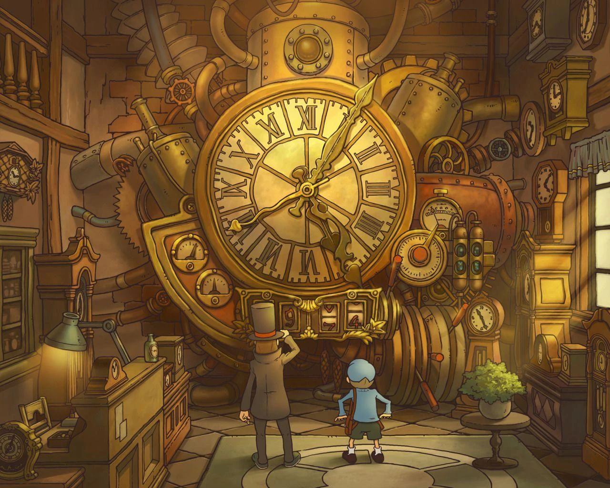
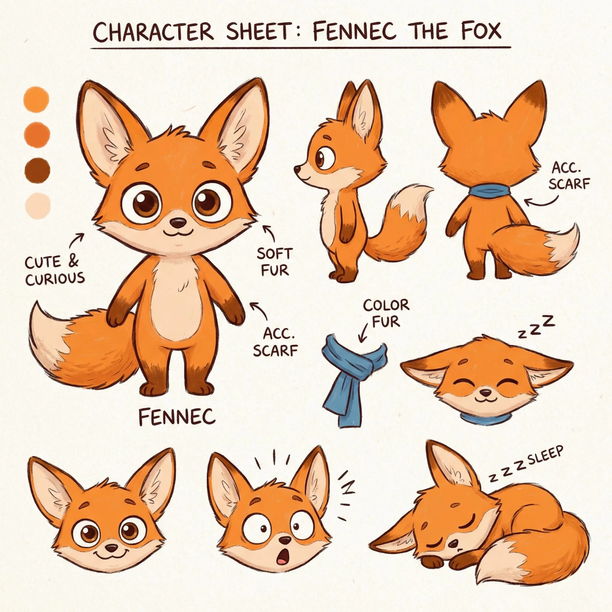
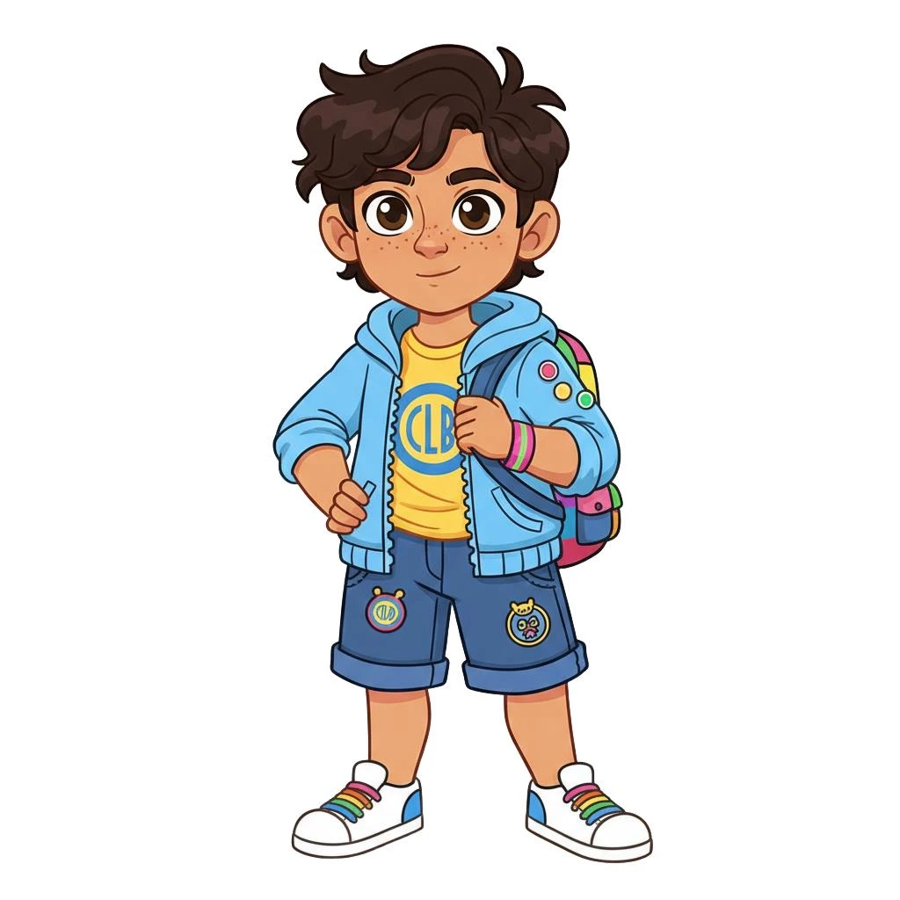
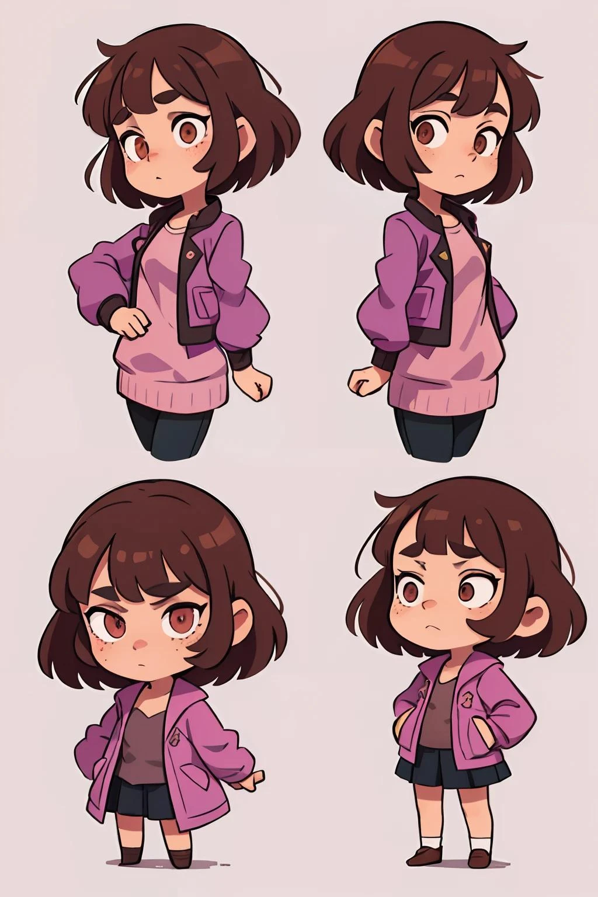
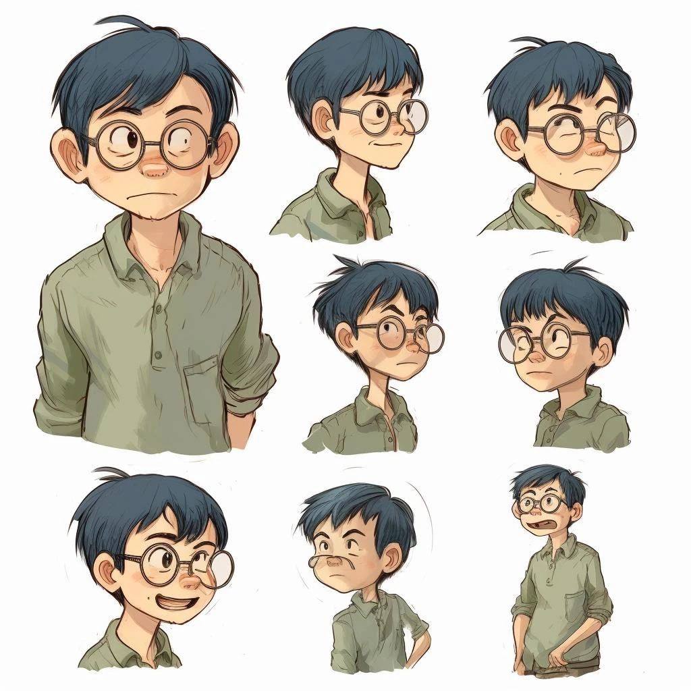

# سند جامع طراحی بازی «رازینو»

**نسخه پیشنهادی محصول تجاری · بازی دوبعدی داستانی و معمایی · اندروید · گروه سنی ۸ تا ۱۲ سال**

> این سند، متن مرجع پروژه است و عیناً از شرح کارفرما ثبت شده است.
> فقط سرفصل‌ها و جدول‌ها برای خوانایی در markdown مرتب شده‌اند؛ در عبارت‌ها دست برده نشده است.

| | |
|---|---|
| مسیر ذخیرهٔ پروژه | <https://github.com/mojtaba-pourasghar/razino> |
| موتور | **Godot 4** — بازی یک اپ معمولی نیست؛ باید با موتور بازی کد زده شود |
| انتخاب فنی | **Godot 4 + GDScript + سیستم محتوای آنلاین نسخه‌بندی‌شده** |
| پلتفرم | اندروید، کافه‌بازار و مایکت |

---

هدف این پروژه ساخت یک بازی کامل و قابل فروش است؛ نه یک نمونه نمایشی. بازی باید داستان چندفصلی، شخصیت‌های متحرک، صداگذاری فارسی، انتخاب‌های اثرگذار، ساخت آواتار کارتونی از چهره کاربر و امکان دانلود فصل‌های جدید از سرور داشته باشد.

پیشنهاد من این است که «رازینو» را مانند یک مجموعه انیمیشنی تعاملی بسازیم: بازیکن وارد دنیایی زنده می‌شود، شخصیت خودش را می‌سازد، در صحنه‌ها حرکت می‌کند، با شخصیت‌ها حرف می‌زند، معما حل می‌کند و با انتخاب‌هایش سرنوشت داستان را تغییر می‌دهد.

---

## ۰. مرجع بصری

تصویرهای زیر مرجع سبک و حال‌وهوا هستند — نه دارایی نهایی و نه چیزی که عیناً کپی شود.

### فضای جهان بازی

| | مرجع |
|---|---|
| ۱ |  |
| ۲ |  |
| ۳ |  |
| ۴ |  |
| ۵ |  |

**آنچه از این مراجع برداشت می‌شود:** نمای کلی شهر ایزومتریک و پرجزئیات، با خانه‌های سفالی، درختان انبوه، چراغ‌های گرم، آب‌نما و پل سنگی، در کنار دریاچه و کوهستان. میدان مرکزی روشن و دوستانه. برج ساعت با مکانیزم برنجی، چرخ‌دنده‌ها و نور گرم کهربایی — قلب داستان. زیرزمین با طاق‌های آجری و چرخ‌دنده‌های بزرگ.

### شخصیت‌ها

| شخصیت | مرجع |
|---|---|
| **فندق** — راهنمای بازی (طرح اولیه) |  |
| **فندق** — مدل‌برگ شخصیت |  |
| **آراد** — شخصیت قابل انتخاب |  |
| **رها** — تحلیل‌گر گروه |  |
| **مانی** — مخترع کوچک |  |

---

## ۱. شناسنامه محصول

| | |
|---|---|
| **نام محصول** | رازینو \| Razino *(نام موقت)* |
| **ژانر** | ماجراجویی دوبعدی، معمایی، داستان تعاملی |
| **گروه سنی** | ۸ تا ۱۲ سال |
| **پلتفرم نسخه اول** | Android، کافه‌بازار و مایکت |
| **موتور** | Godot 4.x، نسخه پایدار سازگار با افزونه‌ها |
| **زبان منطق بازی** | GDScript |
| **زبان محصول** | فارسی، راست‌به‌چپ، صداگذاری ضبط‌شده |
| **مدل محتوا** | بازی پایه + فصل‌های مستقل قابل دانلود |
| **مدل درآمد** | شروع رایگان، خرید فصل، بسته چندفصلی |
| **اتصال اینترنت** | برای دریافت محتوا و تأیید خرید؛ بازی با محتوای دانلودشده آفلاین قابل اجراست |

### ۱.۱. چشم‌انداز محصول

رازینو باید تجربه یک انیمیشن تعاملی را ارائه دهد که در آن بازیکن:

- در محیط دوبعدی حرکت کند و اشیاء را بررسی کند.
- با شخصیت‌های داستان تعامل داشته باشد.
- سرنخ جمع کند و معماهای منطقی حل کند.
- در تصمیم‌های داستانی شرکت کند و نتیجه تصمیم‌هایش را ببیند.
- شخصیت قابل شخصی‌سازی خود را بسازد.
- پیشرفت خود را حفظ کند و فصل‌های بعدی را دانلود کند.

### ۱.۲. اصول طراحی

1. **داستان مقدم بر خرید:** پرداخت نباید برای ادامه هر صحنه کوچک یا حل یک معمای اجباری لازم باشد.
2. **تعامل واقعی:** حداقل بخشی از انتخاب‌ها باید سرنخ، گفت‌وگو، مسیر یا پایان را تغییر دهند.
3. **مناسب سن:** بدون خشونت گرافیکی، محتوای بزرگسالانه، چت آزاد یا ارتباط با غریبه‌ها.
4. **آفلاین‌محور:** محتوای دانلودشده و پیشرفت بازی نباید به اتصال دائمی وابسته باشند.
5. **تولیدپذیری:** فصل‌ها با موتور و قالب داده مشترک ساخته شوند، نه با بازنویسی کد برای هر فصل.
6. **حریم خصوصی:** استفاده از عکس چهره اختیاری باشد و کودک بتواند بدون عکس بازی کند.

### ۱.۳. مزیت رقابتی

مزیت پیشنهادی رازینو باید در ترکیب این ویژگی‌ها باشد:

- داستان معمایی مخصوص سن ۸ تا ۱۲ سال؛
- مسیرهای انتخابی که واقعاً به نتایج متفاوت منتهی می‌شوند؛
- گرافیک دوبعدی حرفه‌ای و شخصیت‌های اختصاصی؛
- فصل‌های پیوسته، ذخیره پیشرفت و محتوای آفلاین؛
- خرید شفاف فصل‌ها به‌جای تبلیغات مزاحم.

---

## ۲. هویت و جهان بازی

### رازینو؛ شهر رازهای گمشده

| | |
|---|---|
| **سبک بصری** | دوبعدی با کیفیت انیمیشن تلویزیونی، پس‌زمینه‌های چندلایه، شخصیت‌های ریگ‌شده و حرکت‌های نرم |
| **مدل عرضه** | بازی پایه همراه فصل اول؛ فصل‌های بعدی به‌صورت بسته‌های محتوایی قابل دانلود از سرور |

### ۲.۱. فضای ایرانی

> **الزام کارفرما:** داستان‌ها باید بر اساس **داستان‌های ایرانی و شهرهای ایرانی** ساخته شوند. محیط‌ها و صحنه‌ها ایران باشند.

این یعنی معماری، بازار، کوچه‌ها، کاشی‌کاری، مدرسه، کتابخانه، جشن، رصدخانه و قنات‌ها باید از فضای واقعی شهرهای ایران برداشت شوند، نه از یک شهر اروپایی عمومی.

### ۲.۲. اصل طراحی

کودک باید بتواند در محیط بازی حرکت کند، اشیاء را بررسی کند، با شخصیت‌ها تعامل داشته باشد، سرنخ جمع کند و در زمان مناسب وارد صحنه‌های داستانی انیمیشنی شود. بازی صرفاً مجموعه‌ای از تصویرهای ثابت و کادرهای دیالوگ نخواهد بود.

### ۲.۳. داستان مرکزی مجموعه

در مرکز شهر رازینو، یک برج ساعت قدیمی قرار دارد. این برج زمانی بخشی از یک سامانه اسرارآمیز برای نگهداری خاطرات و تاریخ شهر بوده است. هر بار که یک راز مهم فراموش می‌شود، یکی از نمادهای برج خاموش می‌شود.

گروهی از کودکان به سرنخ‌هایی دست پیدا می‌کنند که نشان می‌دهد ده راز تاریخی شهر به هم مرتبط‌اند. بازیکن در نقش عضو تازه گروه، به همراه **آراد، رها، مانی و فندق**، باید این رازها را کشف کند.

در هر فصل یک پرونده مستقل حل می‌شود؛ اما سرنخ‌هایی از معمای بزرگ‌تر به دست می‌آید. پایان فصل دهم، پاسخ نهایی را ارائه می‌کند و در عین حال ساختار داستان را برای فصل‌های بعدی باز نگه می‌دارد.

> **نکته داستانی:** رازها ماورایی و ترسناک نیستند؛ محور آن‌ها اختراع‌های قدیمی، رمزها، تاریخ شهر، سوءتفاهم‌ها، طبیعت و تصمیم‌های انسانی است. تعلیق برای این گروه سنی باید هیجان‌انگیز اما امن باشد.

---

## ۳. شخصیت‌ها

### فندق — راهنمای بازی

شخصیت همراه غیرانسانی؛ یک **روباه**. راهنما، دفترچهٔ سرنخ‌ها و سیستم راهنمایی کودک را در قالب یک شخصیت به‌یادماندنی ارائه می‌کند. ظاهر نهایی آن باید مستقل از شخصیت‌های شناخته‌شدهٔ موجود طراحی شود.

### آراد — شخصیت قابل انتخاب

**۱۰ ساله · کنجکاو و ماجراجو**

علاقه‌مند به کشف سرنخ‌ها و حل مسئله. در ابتدای بازی کاربر می‌تواند نام و برخی ویژگی‌های ظاهری او را انتخاب کند.

### رها — تحلیل‌گر گروه

**۱۰ ساله · دقیق و منطقی**

نشانه‌ها را دسته‌بندی می‌کند و به بازیکن کمک می‌کند تناقض‌ها را پیدا کند؛ بدون اینکه پاسخ معما را مستقیم لو بدهد.

### مانی — مخترع کوچک

**۹ ساله · خلاق و شوخ‌طبع**

وسایل ساده می‌سازد و معماهای فیزیکی و مکانیکی را به بخش‌های تعاملی بازی تبدیل می‌کند.

### ۳.۱. انتخاب شخصیت توسط کاربر

کاربر می‌تواند:

- یکی از این شخصیت‌ها را انتخاب کند؛ **یا**
- عکس خودش را بگیرد، آن عکس کارتونی (انیمیشنی) شود و شخصیت خودش را بسازد؛

و در هر دو حالت، بقیهٔ بچه‌ها را به‌عنوان **همراه کمکی** کنار خودش انتخاب کند تا در مسیر به او کمک کنند.

> **نکتهٔ مهم:** تصاویر مرجع بالا برای جهت هنری هستند، نه مدل‌برگ نهایی و تأییدشدهٔ شخصیت‌ها. پیش از تولید انبوه صحنه‌ها باید طراحی اختصاصی شخصیت‌ها، رنگ‌های ثابت، تناسب اندام و استاندارد خروجی گرافیکی نهایی شود.

---

## ۴. تعریف تجربه اصلی بازی (Core Gameplay)

### ۴.۱. چرخه بازی

هر مرحله از بازی باید یک چرخه روشن داشته باشد:

1. ورود به محیط و نمایش انیمیشن کوتاه ورود.
2. حرکت آزاد در محدوده مرحله و بررسی اشیاء.
3. صحبت با شخصیت‌ها و دریافت سرنخ.
4. حل معما یا انتخاب مسیر.
5. نمایش واکنش شخصیت‌ها و نتیجه تصمیم.
6. ثبت پیشرفت و بازشدن مسیر بعدی.
7. نمایش میان‌پرده انیمیشنی در نقاط مهم داستان.

چرخهٔ اصلی بازی از هفت مرحله تشکیل می‌شود:

```
ورود به محیط
   ↓
اکتشاف و حرکت
   ↓
تعامل با شخصیت یا شیء
   ↓
کسب سرنخ یا اطلاعات
   ↓
حل معما یا انتخاب داستانی
   ↓
ثبت پیامد تصمیم
   ↓
باز شدن مسیر یا صحنه جدید
   ↓
میان‌پرده یا پایان قسمت
   ↓
ذخیره پیشرفت
```

بازیکن باید در بیشتر محیط‌ها امکان حرکت به چپ و راست، تعامل با اشیاء، ورود به بعضی ساختمان‌ها و بازگشت به مکان‌های قبلی را داشته باشد. بخش‌هایی که صرفاً برای روایت هستند، می‌توانند به‌صورت صحنه‌های سینمایی اجرا شوند.

### ۴.۲. ساختار مرحله‌ای شبیه بازی‌های استراتژیک

> **الزام کارفرما:** یک محیطی شبیه بازی‌های استراتژیک که بازیکن باید هر مرحله را درست کند، با ابزارهای مختلف، و **راز هر مرحله** را پیدا کند.

هر مرحله باید:

- یک راز یا هدف مشخص داشته باشد که باید کشف شود؛
- چند ابزار در اختیار بازیکن بگذارد که انتخاب درست ابزار بخشی از حل مسئله باشد؛
- بیش از یک راه حل یا مسیر داشته باشد؛
- با کمک شخصیت‌های همراه، مسیرهای تازه‌ای باز کند.

### ۴.۳. کنترل بازیکن

- حرکت به چپ و راست با کنترل لمسی.
- دکمه تعامل برای صحبت، بررسی و برداشتن اشیاء.
- امکان لمس مستقیم اشیاء قابل تعامل.
- دکمه دفتر سرنخ‌ها و نقشه مرحله.
- امکان توقف بازی، تنظیم صدا و بازگشت به منو.
- پشتیبانی از دستگاه‌های مختلف با نسبت تصویر متفاوت.

در محیط‌های اکتشافی، حرکت شخصیت آزاد و محدود به محدوده تعریف‌شده مرحله است. در صحنه‌های روایی، کنترل حرکت موقتاً به سیستم داستان منتقل می‌شود.

### ۴.۴. انواع تعامل

| شناسه | تعامل | نمونه |
|---|---|---|
| INT-01 | Examine | بررسی ساعت، کتاب یا نقشه |
| INT-02 | Talk | گفت‌وگو با شخصیت |
| INT-03 | Collect | برداشتن سرنخ |
| INT-04 | Combine | ترکیب دو شیء یا نشانه |
| INT-05 | Puzzle | حل رمز، ترتیب یا الگو |
| INT-06 | Choice | انتخاب مسیر داستان |
| INT-07 | Inspect | بررسی دفترچه یا نقشه |
| INT-08 | Trigger | فعال‌کردن رویداد سینمایی |

هر تعامل باید شناسه ثابت داشته باشد تا در سیستم رویدادها، ذخیره پیشرفت و تست خودکار قابل ردیابی باشد.

---

## ۵. بازیکنان، رقابت و کمک — الزامات تازه

> این بخش از الزامات تازهٔ کارفرماست و در نسخهٔ اول سند وجود نداشت.

### ۵.۱. ثبت‌نام

افراد با **شماره موبایل و نام** ثبت‌نام می‌کنند و بازی شروع می‌شود.

### ۵.۲. رقابت بین بازیکنان

بازیکن‌های حاضر باید بتوانند با هم رقابت کنند. هر فردی باید **بر اساس همان فصل** با فرد دیگری رقابت کند.

### ۵.۳. کمک بازیکنان به یکدیگر

- افراد دیگر می‌توانند به کاربر در این مسیر کمک کنند.
- هر **کاراکتر کمکی** قابلیت‌هایی دارد که می‌تواند مسیر بازیکن را بازتر کند.

### ۵.۴. اقتصاد درون‌بازی

- بعضی از کاراکترها و ابزارها **خریدنی** هستند.
- خرید یا بر اساس **سکه و الماس** است، یا از طریق **درگاه کافه‌بازار** و پرداخت پول.

---

## ۶. ساختار کامل ده فصل

هر فصل یک داستان کامل با شروع، بحران، کشف و پایان دارد. در کنار آن، یک سرنخ اصلی به داستان کل مجموعه اضافه می‌شود.

| فصل | عنوان | محیط اصلی | مکانیک محوری | سرنخ کلان |
|---|---|---|---|---|
| ۱ | راز ساعت خاموش | مدرسه و برج ساعت | آموزش تعامل، کشف سرنخ | نشان ده‌پرتو |
| ۲ | کتابخانه هزار در | کتابخانه و آرشیو | رمزگشایی و جست‌وجو | نام مخترع |
| ۳ | جنگل نشانه‌ها | جنگل و آبشار | مسیر‌یابی و مشاهده | قطعه دستگاه |
| ۴ | کارگاه مخترع | کارگاه و آزمایشگاه | چرخ‌دنده و ترکیب اشیاء | نقشه زیرزمین |
| ۵ | راز دریاچه آبی | اسکله و ایستگاه پژوهشی | آزمایش و علت‌ومعلول | پیام مخترع |
| ۶ | جشن هزار چراغ | بازار و میدان شهر | گفت‌وگو و بررسی تناقض | نگهبان سابق برج |
| ۷ | رصدخانه ستاره‌ها | رصدخانه | الگو و ترتیب منطقی | ساختار ده نماد |
| ۸ | شهر زیر شهر | تونل‌ها و تالار زیرزمینی | نقشه و اکتشاف | علت خاموشی دستگاه |
| ۹ | ده کلید | تالار نمادها | ترکیب سرنخ‌های قبلی | دسترسی به قلب دستگاه |
| ۱۰ | قلب رازینو | برج ساعت | معمای نهایی و تصمیم | حل داستان اصلی |

### فصل ۱ — راز ساعت خاموش
*آموزش و ورود به بازی*

ساعت برج شهر پس از سال‌ها به صدا درمی‌آید. تکه‌ای نقشه درون آن پیدا می‌شود. بازیکن شخصیت خود را می‌سازد، گروه را می‌شناسد و یاد می‌گیرد چگونه حرکت کند، اشیاء را بررسی کند و سرنخ‌ها را ثبت کند.

- **مراحل:** حیاط مدرسه، راهروی قدیمی، کتابخانه، اتاق زیرشیروانی و برج ساعت.
- **پایان:** یک نشان ناشناس با نماد ده پرتو پیدا می‌شود.

### فصل ۲ — کتابخانه هزار در
*جست‌وجو و رمزگشایی*

کتابی که نقشه قدیمی شهر را در خود دارد ناپدید شده است. گروه باید از روی نشانه‌های کتاب‌ها، ترتیب قفسه‌ها و یادداشت‌های یک کتابدار بازنشسته، مسیر مخفی را پیدا کند.

- **مراحل:** سالن کتاب‌ها، اتاق اسناد، بخش نقشه‌ها و راهروی قفسه‌های متحرک.
- **پایان:** نام مخترعی پیدا می‌شود که در طراحی برج ساعت نقش داشته است.

### فصل ۳ — جنگل نشانه‌ها
*اکتشاف و حل معما*

نقشه گروه را به جنگلی در حاشیه شهر می‌رساند. نشانه‌های روی سنگ‌ها به ترتیب خاصی قرار دارند. بازیکن باید مسیر امن را انتخاب کند و با مشاهده محیط، راه عبور از رودخانه را بیابد.

- **مراحل:** اردوگاه، مسیر سنگی، پل چوبی، آبشار و کلبه متروکه.
- **پایان:** بخشی از یک دستگاه قدیمی در کلبه پیدا می‌شود.

### فصل ۴ — کارگاه مخترع
*ساخت و آزمایش*

گروه به کارگاه مخترع می‌رسد. مانی می‌فهمد دستگاه قدیمی فقط با تنظیم درست چرخ‌دنده‌ها کار می‌کند. بازیکن قطعات را جابه‌جا می‌کند و یک وسیله کوچک برای بازکردن صندوقچه می‌سازد.

- **مراحل:** انبار قطعات، میز طراحی، آزمایشگاه کوچک و اتاق دستگاه‌ها.
- **پایان:** نقشه‌ای از شبکه زیرزمینی شهر ظاهر می‌شود.

### فصل ۵ — راز دریاچه آبی
*مشاهده علمی*

یکی از مسیرهای دستگاه به ایستگاه پژوهشی کنار دریاچه می‌رسد. گروه باید علت تغییر رنگ آب در یک بخش را بررسی کند. معماها درباره نور، بازتاب، زنجیره علت و معلول و مشاهده دقیق‌اند.

- **مراحل:** اسکله، آزمایشگاه آب، تونل شیشه‌ای و سکوی اندازه‌گیری.
- **پایان:** پیام صوتی مخترع درباره ده نماد برج پیدا می‌شود.

### فصل ۶ — جشن هزار چراغ
*گفت‌وگو و تصمیم‌گیری*

در جشن سالانه شهر، گروه متوجه می‌شود که چند وسیله تاریخی اشتباه در غرفه‌ها قرار گرفته‌اند. بازیکن باید از شاهدان سؤال کند، اطلاعات متناقض را تشخیص دهد و با تصمیم خود از متهم‌شدن اشتباه یک شخصیت جلوگیری کند.

- **مراحل:** میدان جشن، بازارچه، غرفه صنایع دستی و صحنه اصلی.
- **پایان:** هویت نگهبان سابق برج آشکار می‌شود.

### فصل ۷ — رصدخانه ستاره‌ها
*الگو و منطق*

گروه به رصدخانه بالای تپه می‌رود. یک نقشه ستاره‌ای و مجموعه‌ای از زمان‌ها نشان می‌دهند که نمادهای برج بر اساس الگویی دقیق مرتب شده‌اند.

- **مراحل:** راه کوهستان، اتاق تلسکوپ، تالار نقشه‌ها و گنبد رصدخانه.
- **پایان:** گروه می‌فهمد ده نماد، بخش‌های یک دستگاه واحدند.

### فصل ۸ — شهر زیر شهر
*اکتشاف پیشرفته*

در زیرزمین شهر، راهروهایی قدیمی وجود دارد. گروه باید مسیرها را روی نقشه ثبت کند، دریچه‌ها را فعال کند و از خطرهای ساده محیطی عبور کند.

- **مراحل:** ورودی تونل، اتاق نقشه، پلکان سنگی و تالار مرکزی.
- **پایان:** یک پیام قدیمی نشان می‌دهد چرا دستگاه برج از کار افتاده است.

### فصل ۹ — ده کلید
*ترکیب سرنخ‌ها*

گروه باید اطلاعات جمع‌آوری‌شده از فصل‌های قبل را کنار هم بگذارد. هر نماد یک بخش از دستگاه را فعال می‌کند و انتخاب ترتیب فعال‌سازی روی مسیر رسیدن به اتاق نهایی اثر می‌گذارد.

- **مراحل:** تالار نمادها، اتاق کلیدها، سکوی دستگاه و ورودی محفظه مرکزی.
- **پایان:** درِ اتاق اصلی باز می‌شود؛ اما دستگاه بدون یک قطعه مهم کار نمی‌کند.

### فصل ۱۰ — قلب رازینو
*پایان داستان اصلی*

گروه با آخرین معما روبه‌رو می‌شود. مشخص می‌شود مخترع دستگاه قصد نداشته رازها را برای همیشه پنهان کند؛ او سامانه‌ای ساخته بود تا تاریخ شهر حفظ شود و هر نسل بتواند با کشف و همکاری، آن را دوباره فعال کند.

بازیکن تصمیم می‌گیرد چگونه دانش کشف‌شده را به شهر منتقل کند و چه کسی مسئول نگهداری آرشیو جدید باشد.

- **پایان:** برج ساعت دوباره روشن می‌شود و در آخرین صحنه، نقشه‌ای تازه از منطقه‌ای ناشناخته ظاهر می‌شود. این نقشه مقدمه فصل‌های آینده است.

> این ده فصل، خط اصلی روایت را تشکیل می‌دهند. برای تبدیل آن به بازی کامل، هر فصل باید به صحنه‌های قابل بازی، دیالوگ‌های دقیق، معماهای پیاده‌سازی‌شده، انیمیشن‌ها، صداها، شرایط انتخاب و پایان‌های مشخص شکسته شود.

### ۶.۱. قرارداد محتوایی هر فصل

هر فصل باید این اقلام را تحویل دهد:

- خلاصه داستان و هدف روایی.
- فهرست صحنه‌ها با شناسه ثابت.
- نمودار مسیرهای انتخابی.
- متن نهایی تمام دیالوگ‌ها.
- فهرست تعامل‌ها و معماها.
- فهرست پس‌زمینه‌ها و اجزای هنری.
- فهرست انیمیشن‌ها و میان‌پرده‌ها.
- فایل‌های صوتی و زیرنویس.
- شروط بازشدن هر صحنه.
- آزمون‌های پذیرش و وضعیت تکمیل محتوا.

### ۶.۲. مقیاس اولیه تولید

| | |
|---|---|
| صحنه‌های داستانی و قابل بازی در هر فصل | ۱۵–۲۵ |
| قسمت‌های داستانی در هر فصل | ۴ |
| صحنه‌های اختصاصی در ده فصل | ۱۵۰–۲۵۰ |
| مدت هدف برای یک فصل | ۶۰–۱۲۰ دقیقه |

این اعداد هدف برنامه‌ریزی هستند، نه مشخصات نهایی و تأییدشده. طول واقعی بازی باید پس از طراحی یک فصل کامل، تست با کودکان و بررسی زمان حل معماها تنظیم شود.

---

## ۷. طراحی داستان و منطق شاخه‌ها

سیستم داستان باید داده‌محور باشد. نویسنده بتواند با ابزار مدیریت محتوا، دیالوگ و انتخاب را تعریف کند، بدون اینکه برای هر انتخاب کد جدیدی نوشته شود.

### ۷.۱. متغیرهای داستانی

| نام متغیر | نوع | کاربرد |
|---|---|---|
| `player_name` | String | نام نمایشی شخصیت |
| `trust_raad` | Integer | سطح اعتماد یک شخصیت |
| `clues` | Set | فهرست سرنخ‌های کشف‌شده |
| `inventory` | Set | اشیاء در اختیار بازیکن |
| `story_flags` | Dictionary | رویدادهای مهم انجام‌شده |
| `chapter_progress` | Dictionary | پیشرفت هر قسمت |
| `ending_id` | String | پایان انتخاب‌شده |
| `avatar_id` | String | شناسه آواتار انتخاب‌شده |

مقادیر اعتماد و پرچم‌های داستانی فقط وقتی استفاده شوند که اثر واقعی روی دیالوگ یا مسیر داشته باشند. تعداد زیاد متغیرهای بدون کاربرد، نگهداری داستان را دشوار می‌کند.

### ۷.۲. نمونه نمودار انتخاب

```
            پیدا شدن دفتر قدیمی
                    ↓
                انتخاب بازیکن
        ┌───────────┼───────────┐
        ↓           ↓           ↓
نشان دادن دفتر  بررسی دفتر   جست‌وجوی
 به کتابدار      با رها      نقشه دوم
        ↓           ↓           ↓
   سرنخ درباره  کشف رمز در  پیدا شدن
     مخترع        صفحات     نقشه ناقص
        └───────────┼───────────┘
                    ↓
            ورود به مرحله بعد
```

سه مسیر می‌توانند به مرحله بعد مشترک برسند، اما باید نتیجه متفاوتی به جا بگذارند: مثلاً یک گفت‌وگوی ویژه، سرنخ اختیاری یا امتیاز اعتماد.

### ۷.۳. قواعد طراحی انتخاب

- هر گزینه باید از متن آن قابل فهم باشد.
- پیامد انتخاب نباید به‌صورت فریبنده پنهان شود.
- هیچ انتخابی نباید باعث از دست‌رفتن دائمی امکان تکمیل داستان شود.
- مسیر اشتباه باید به راهنمایی یا فرصت اصلاح منتهی شود.
- پایان‌های مختلف باید تفاوت محتوایی مشخص داشته باشند، نه فقط تغییر یک جمله.
- در صورت تکرار فصل، بازیکن بتواند انتخاب‌های قبلی را مرور کند.
- اگر فصل بعدی به سرنخ اختیاری وابسته است، باید مسیر جایگزین معقولی برای بازیکن وجود داشته باشد.

---

## ۸. مشخصات فصل اول برای تولید

فصل اول نمونه معیار برای تثبیت موتور، سیستم هنری، سیستم دانلود و قالب فصل‌های آینده است.

### ۸.۱. مشخصات روایی

**فصل ۱: راز ساعت خاموش** · ۴ قسمت · ۱۵–۲۵ صحنه هدف · معمایی · آموزش کنترل

- **هدف بازیکن:** کشف علت به صدا درآمدن ساعت و پیدا کردن نشان ده‌پرتو.
- **هدف آموزشی غیرمستقیم:** مشاهده دقیق، ترتیب‌دادن نشانه‌ها، حل مسئله و همکاری.
- **هدف محصولی:** آموزش کنترل‌ها، تعامل با اشیاء، دفتر سرنخ‌ها، انتخاب داستانی و ذخیره پیشرفت.

### ۸.۲. ساختار چهار قسمت

**S01-E01 — صدای ساعت**
بازیکن وارد حیاط مدرسه می‌شود، با آراد آشنا می‌شود و پس از شنیدن صدای برج، سه نقطه را بررسی می‌کند. انتخاب سرنخ صحیح، راه ورود به راهروی قدیمی را باز می‌کند.

**S01-E02 — راهروی قدیمی**
بازیکن دفترچه‌ای پیدا می‌کند. با کمک رها، نشانه‌های آن را مرتب می‌کند. انتخاب بازیکن تعیین می‌کند کدام گفت‌وگو و سرنخ جانبی باز شود.

**S01-E03 — کتابخانه و اتاقک بالا**
بازیکن با تعامل محیطی، کلید صندوقچه را پیدا می‌کند و یک معمای ترتیبی حل می‌کند. میان‌پرده کوتاهی رابطه نشان ده‌پرتو با برج را نشان می‌دهد.

**S01-E04 — نشان ده‌پرتو**
گروه به محفظه برج می‌رسد. بازیکن باید سه نشانه را به ترتیب بچیند. پس از موفقیت، دستگاه واکنش نشان می‌دهد و نام مخترع قدیمی آشکار می‌شود.

### ۸.۳. معیار تکمیل فصل اول

فصل زمانی آماده انتشار است که:

- تمام صحنه‌ها و مسیرها قابل دسترسی باشند.
- هیچ انتخابی به مقصد نامعتبر منتهی نشود.
- ذخیره و ادامه بازی در تمام نقاط مجاز کار کند.
- صدا و زیرنویس با یکدیگر هماهنگ باشند.
- فصل روی دستگاه‌های هدف بدون خطای بحرانی اجرا شود.
- بسته فصل از سرور دریافت و آفلاین اجرا شود.
- در صورت دانلود ناقص یا نسخه ناسازگار، بازی پیام واضح نشان دهد.
- والد بتواند خریدها و تنظیمات مربوط به کودک را مدیریت کند.

---

## ۹. انیمیشن‌ها و حرکت شخصیت‌ها

برای رسیدن به کیفیت مناسب، انیمیشن نباید به حرکت‌دادن یک تصویر ثابت محدود شود. شخصیت‌ها باید اجزای بدن مستقل، حالت‌های صورت و انیمیشن‌های قابل ترکیب داشته باشند.

### ۹.۱. فهرست انیمیشن‌های ضروری

| دسته | انیمیشن‌ها |
|---|---|
| حرکت پایه | ایستادن، راه‌رفتن، دویدن، توقف، چرخیدن |
| تعامل | اشاره، برداشتن شیء، بازکردن در، بررسی سرنخ |
| گفت‌وگو | حرف‌زدن، گوش‌دادن، پلک‌زدن، حرکت سر و دست |
| واکنش | تعجب، شادی، نگرانی ملایم، فکرکردن، خنده |
| معما | بررسی نقشه، چیدن قطعات، فعال‌کردن دستگاه |
| پاداش | بازشدن صندوق، پیدا‌شدن سرنخ، تکمیل مأموریت |
| سینمایی | ورود شخصیت، تغییر دوربین، نمایش کشف مهم، پایان فصل |

برای هر شخصیت اصلی باید حالت‌های چهره مستقل طراحی شوند. حرکت لب‌ها می‌تواند با صدای از پیش ضبط‌شده هماهنگ شود؛ لازم نیست برای هر دیالوگ انیمیشن کامل و پرهزینه ساخته شود.

### ۹.۲. انیمیشن ابتدای فصل

هر فصل با یک میان‌پرده حدود **۲۰ تا ۴۵ ثانیه‌ای** شروع می‌شود:

- نمایی از محیط فصل؛
- حرکت دوربین به سمت نقطه مهم؛
- نمایش شخصیت‌های حاضر؛
- وقوع اتفاق آغازگر داستان؛
- نمایش عنوان فصل و ورود به مرحله قابل بازی.

مدت دقیق باید با ریتم داستان تنظیم شود و امکان ردکردن میان‌پرده برای کاربری که قبلاً آن را دیده فراهم باشد.

### ۹.۳. میان‌پرده‌های حین بازی

در نقاط مهم، بازی از کنترل آزاد به روایت سینمایی منتقل می‌شود. برای مثال، هنگامی که ساعت برج روشن می‌شود، دوربین به سمت برج حرکت می‌کند، چرخ‌دنده‌ها شروع به چرخش می‌کنند، نور از پنجره‌ها عبور می‌کند و شخصیت‌ها واکنش نشان می‌دهند.

پس از پایان میان‌پرده، کنترل به بازیکن برمی‌گردد. این انتقال باید نرم باشد و وضعیت بازی، انتخاب‌های قبلی و محل قرارگیری شخصیت را حفظ کند.

### ۹.۴. حرکت دوربین و عمق محیط

برای محیط دوبعدی با ظاهر غنی، پیشنهاد من استفاده از چند لایه تصویری است:

- لایه پس‌زمینه دور؛
- ساختمان‌ها و اشیای میانی؛
- مسیر حرکت شخصیت؛
- اشیای نزدیک دوربین؛
- افکت‌های محیطی مانند برگ، گردوغبار، باران ملایم و نور.

با حرکت دوربین، لایه‌ها با سرعت متفاوت جابه‌جا می‌شوند؛ این تکنیک **پارالاکس** نام دارد و حس عمق ایجاد می‌کند، بدون اینکه نیاز به ساخت محیط سه‌بعدی داشته باشیم.

---

## ۱۰. طراحی هنری و استاندارد گرافیک دوبعدی

کیفیت بصری باید در تمام فصل‌ها یکپارچه باشد. استفاده از تصاویر تولیدشده به‌صورت پراکنده بدون راهنمای هنری، باعث تغییر چهره شخصیت‌ها، تفاوت رنگ و تناسب و افت کیفیت محصول می‌شود.

### ۱۰.۱. سبک هنری مصوب پیشنهادی

- دوبعدی نقاشی‌شده با لبه‌های تمیز و سایه‌پردازی نرم.
- شخصیت‌های کارتونی با نسبت‌های بدنی ثابت و حالات چهره خوانا.
- پس‌زمینه‌های چندلایه با پارالاکس.
- رنگ‌های گرم برای محیط‌های امن و رنگ‌های متمایز برای مکان‌های معمایی.
- افکت‌های نوری و ذرات با مصرف محدود حافظه.
- عدم استفاده از گرادیان‌های تصادفی یا تغییر سبک میان فصل‌ها.
- رابط کاربری مستقل از سبک تصویرسازی محیط.

### ۱۰.۲. فهرست اولیه دارایی‌های هنری

| دسته | دارایی‌های هدف برای برنامه‌ریزی |
|---|---|
| شخصیت‌های اصلی | ۴ شخصیت ثابت + آواتار بازیکن |
| شخصیت‌های فرعی | براساس نیاز هر فصل |
| محیط‌های اصلی | ۱۰ مجموعه محیطی، یک مجموعه برای هر فصل |
| پس‌زمینه‌ها | حدود ۴۰ تا ۷۰ تصویر قابل استفاده مجدد یا اختصاصی |
| انیمیشن‌های مشترک | حرکت پایه، گفت‌وگو، تعامل و واکنش |
| میان‌پرده‌ها | حدود ۲ تا ۴ میان‌پرده برای هر فصل |
| رابط کاربری | منو، دیالوگ، دفتر سرنخ، نقشه، فروشگاه، دانلود و تنظیمات |
| افکت‌ها | ذرات، نور، گردوغبار، بازشدن صندوق، حرکت چرخ‌دنده |

این فهرست برآورد اولیه است. تعداد نهایی پس‌زمینه‌ها به میزان استفاده مجدد، طول هر صحنه و طراحی واقعی محیط‌ها بستگی دارد.

### ۱۰.۳. استاندارد تحویل تصویر

هر دارایی باید شناسه، نسخه، اندازه، فرمت، محل استفاده و مالکیت مشخص داشته باشد. برای نمونه:

```
BG_S01_SCHOOL_YARD_V001.webp
BG_S01_CLOCK_TOWER_V001.webp
CHR_ARAD_IDLE_V001
CHR_ARAD_WALK_V001
CHR_RAHA_TALK_V001
FX_CLOCK_ACTIVATE_V001
UI_DIALOG_PANEL_V001
```

نام‌گذاری واقعی می‌تواند تغییر کند، اما باید در تمام تیم ثابت بماند.

تصاویر باید برای رزولوشن‌های موبایل بهینه شوند. تصویر پس‌زمینه نباید به‌اندازه تمام رزولوشن‌های ممکن تکرار شود؛ موتور باید بتواند آن را در نسبت‌های تصویر متفاوت نمایش دهد، بدون اینکه بخش مهم صحنه بریده شود.

### ۱۰.۴. ریگ و انیمیشن

برای شخصیت‌های اصلی، سیستم ریگ استخوانی یا یک راهکار معادل توصیه می‌شود. هر شخصیت باید دارای موارد زیر باشد:

- اسکلت یا ساختار اجزای متحرک.
- انیمیشن‌های پایه قابل ترکیب.
- حالت‌های صورت.
- نقاط اتصال وسایل.
- لایه‌بندی صحیح دست، بدن و سر.
- انیمیشن تعامل با اشیاء.
- حالت‌های سینمایی و گفت‌وگو.

انیمیشن‌ها باید از طریق سیستم مشترک مدیریت شوند؛ برای مثال، سیستم داستان رویداد `play_animation("surprised")` را درخواست کند، نه اینکه منطق داستان مستقیماً به فایل‌های داخلی انیمیشن وابسته شود.

---

## ۱۱. طراحی رابط کاربری و تجربه کاربر

رابط کاربری باید حس یک بازی داستانی واقعی را منتقل کند، نه یک کتاب الکترونیکی که چند دکمه به آن اضافه شده است. پیشنهاد من استفاده از تصویرهای تمام‌صفحه دوبعدی، رابط خلوت، کارت‌های تخت، گوشه‌های نرم و دکمه‌های واضح با تایپوگرافی فارسی خواناست.

### ۱۱.۱. صفحه‌های اصلی

**صفحه ۱ — خانه**

- تصویر شخصیت اصلی و فضای داستان
- دکمه بزرگ «ادامه ماجرا»
- نمایش فصل فعلی و درصد پیشرفت
- میان‌بر «داستان‌ها»، «دفتر سرنخ‌ها» و «لباس‌ها»
- تنظیمات و بخش والدین در جایگاهی مشخص

صفحه خانه باید در چند ثانیه به کودک نشان دهد از کجا می‌تواند بازی را ادامه دهد.

**صفحه ۲ — صحنه داستان**

- تصویر پس‌زمینه با شخصیت‌های دارای حالت‌های مختلف
- کادر دیالوگ با فونت فارسی خوانا
- دکمه ادامه گفت‌وگو
- نمایش دو یا سه انتخاب در زمان تصمیم‌گیری
- امکان پخش مجدد صدای دیالوگ

متن نباید روی بخش مهم تصویر قرار بگیرد. انتخاب‌ها باید به‌وضوح قابل لمس باشند.

**صفحه ۳ — دفتر سرنخ‌ها**

- سرنخ‌های پیدا‌شده
- نقشه و یادداشت‌های شخصیت
- امکان کنار هم گذاشتن نشانه‌ها
- معماهای حل‌نشده و سرنخ‌های جدید

این بخش یکی از تفاوت‌های مهم بازی با داستان‌های معمولی است و باید تعامل واقعی داشته باشد.

**صفحه ۴ — نقشه فصل‌ها**

- فصل‌های باز و قفل‌شده
- خلاصه هر قسمت
- وضعیت تکمیل داستان
- مشخص‌بودن قسمت‌های رایگان و خریدنی

قفل‌بودن فصل‌ها باید شفاف باشد و کودک را با وعده‌های گمراه‌کننده به خرید سوق ندهد.

**صفحه ۵ — شخصی‌سازی**

- لباس و وسایل شخصیت
- آیتم‌های به‌دست‌آمده از بازی
- پیش‌نمایش ظاهر
- آیتم‌های قابل خرید با قیمت مشخص

شخصی‌سازی باید اختیاری باشد؛ کودک برای پیش‌برد داستان مجبور به خرید لباس یا ظاهر ویژه نشود.

**صفحه ۶ — بخش والدین**

- کنترل خرید و تأیید پرداخت
- تنظیم صدا و دانلود محتوای آفلاین
- مدیریت فضای ذخیره‌سازی
- سیاست حریم خصوصی و حذف داده‌ها
- مشاهده فصل‌های خریداری‌شده

این بخش باید از محیط کودک جدا باشد و دسترسی به خریدها به تأیید بزرگسال وابسته باشد.

### ۱۱.۲. فهرست کامل صفحات

| شناسه | صفحه | هدف |
|---|---|---|
| UI-01 | Splash | بارگذاری اولیه |
| UI-02 | معرفی اولیه | آموزش کوتاه کنترل‌ها |
| UI-03 | ساخت شخصیت | انتخاب یا ساخت آواتار |
| UI-04 | خانه | ادامه بازی و دسترسی به بخش‌ها |
| UI-05 | نقشه جهان | انتخاب مکان‌های بازشده |
| UI-06 | محیط قابل بازی | حرکت و تعامل |
| UI-07 | دیالوگ و انتخاب | نمایش متن و گزینه‌ها |
| UI-08 | دفتر سرنخ‌ها | مدیریت اطلاعات کشف‌شده |
| UI-09 | معما | حل مسئله تعاملی |
| UI-10 | نقشه فصل‌ها | مشاهده و دانلود فصل |
| UI-11 | فروشگاه | خرید فصل و بسته |
| UI-12 | آواتار | تغییر ظاهر شخصیت |
| UI-13 | تنظیمات | صدا، زبان و کنترل‌ها |
| UI-14 | بخش والدین | خرید، حریم خصوصی و مدیریت |
| UI-15 | دانلودها | مدیریت محتوای دریافت‌شده |
| UI-16 | خطا و بازیابی | رفع مشکل شبکه، فایل یا ذخیره |

### ۱۱.۳. قواعد طراحی رابط

- تمام صفحات باید در جهت راست‌به‌چپ درست نمایش داده شوند.
- فونت فارسی باید خوانا و دارای مجوز استفاده تجاری باشد.
- ناحیه لمس دکمه‌ها برای دست کودک مناسب باشد؛ هدف اولیه حداقل حدود ۴۸ واحد منطقی در رابط است.
- متن دیالوگ در هر صفحه بیش از حد طولانی نباشد.
- رنگ تنها نشانه موفقیت یا خطا نباشد؛ از آیکن و متن هم استفاده شود.
- تمام گزینه‌های خرید قیمت مشخص و توضیح روشن داشته باشند.
- کنترل‌های محیط بازی با کادر دیالوگ و دفتر سرنخ تداخل نداشته باشند.
- در دستگاه‌های کم‌عرض، اندازه عناصر کاهش یابد اما متن و دکمه‌های اصلی غیرقابل‌خواندن نشوند.

---

## ۱۲. مدل اقتصادی و فروش

برای این گروه سنی، مدل پیشنهادی من رایگان‌بودن شروع بازی و فروش مستقیم فصل‌های داستانی است. این مدل به خانواده اجازه می‌دهد قبل از پرداخت، کیفیت محصول را ارزیابی کند.

> قیمت‌های زیر صرفاً فرضیه اولیه برای آزمایش بازار ایران هستند، نه قیمت‌های بررسی‌شده یا قطعی.

| محصول | شرح | قیمت اولیه پیشنهادی | نقش |
|---|---|---|---|
| شروع رایگان | قسمت اول و بخشی از قسمت دوم | ۰ تومان | جذب کاربر |
| بسته یک فصل | ۴ قسمت، پایان کامل و ذخیره پیشرفت | ۹۹ تا ۱۴۹ هزار تومان | درآمد اصلی |
| بسته چندفصلی | ۳ فصل با تخفیف نسبت به خرید جداگانه | ۲۴۹ تا ۳۴۹ هزار تومان | خرید بیشتر |
| آیتم‌های ظاهری | اختیاری | با قیمت شفاف | — |

قیمت نهایی باید با آزمایش تمایل به پرداخت والدین، هزینه تولید هر فصل، سهم فروشگاه، مالیات و هزینه پشتیبانی تعیین شود. قیمت‌گذاری ریالی نیز باید امکان تغییر از راه تنظیمات سرور را داشته باشد تا به‌روزرسانی قیمت‌ها نیازمند انتشار نسخه جدید اپ نباشد.

### ۱۲.۱. قواعد فروش

- محتوای رایگان باید برای ارزیابی کیفیت کافی باشد.
- هیچ معمای ضروری با پرداخت مستقیم حل نشود.
- پیش از خرید، فهرست قسمت‌ها و محتوای بسته مشخص باشد.
- خرید دوباره یک بسته قبلاً خریداری‌شده نباید به پرداخت مجدد منجر شود.
- رسید خرید از مسیر معتبر فروشگاه تأیید شود.
- خرید و بازگردانی خرید باید قابل آزمایش باشد.
- سیستم فروش نباید به سرور فایل‌های گرافیکی به‌تنهایی اعتماد کند؛ مجوز دسترسی باید از مسیر امن تأیید شود.

### ۱۲.۲. شاخص‌های اقتصادی

پس از انتشار، این شاخص‌ها اندازه‌گیری شوند:

- نرخ تکمیل فصل اول.
- درصد بازگشت کاربر در روزهای بعد.
- نرخ تبدیل کاربران فعال به خریدار.
- درآمد متوسط به ازای کاربر فعال.
- درصد کاربرانی که فصل بعدی را دانلود می‌کنند.
- هزینه تولید هر دقیقه محتوای قابل بازی.
- نرخ خطای دانلود و بازپرداخت خرید.

آمار باید تا حد امکان تجمیعی و با حداقل داده شخصی جمع‌آوری شود؛ به‌ویژه چون مخاطب کودک است.

---

## ۱۳. معماری دانلود آنلاین فصل‌ها

این بخش از مهم‌ترین تصمیم‌های فنی پروژه است. نباید برای اضافه‌کردن فصل یازدهم، دوازدهم یا هر فصل جدید، مجبور شویم هر بار نسخه جدید اپ را در کافه‌بازار و مایکت منتشر کنیم.

باید از ابتدا بازی را به دو بخش مستقل تقسیم کنیم:

**اپلیکیشن اصلی نصب‌شده**
موتور بازی، رابط کاربری، سیستم انیمیشن، ذخیره پیشرفت، مدیریت دانلود و اجرای معماها

**سرور کاتالوگ محتوا**
فهرست فصل‌ها، شماره نسخه، پیش‌نیازها، وضعیت انتشار، اندازه فایل و اطلاعات دسترسی

**بسته محتوایی هر فصل**
پس‌زمینه‌ها، صداها، دیالوگ‌ها، انیمیشن‌ها، داده صحنه‌ها و معماهای همان فصل

### ۱۳.۱. فرایند دانلود از دید بازیکن

1. بازیکن وارد صفحه فصل‌ها می‌شود.
2. بازی کاتالوگ به‌روز را از سرور دریافت می‌کند.
3. فصل‌های نصب‌شده، قابل دانلود، رایگان و خریدنی مشخص می‌شوند.
4. پس از انتخاب فصل، وضعیت دسترسی کاربر بررسی می‌شود.
5. بسته فصل دانلود می‌شود، اندازه و صحت فایل‌ها بررسی می‌شوند و محتوا در محل موقت استخراج می‌شود.
6. پس از تأیید کامل فایل‌ها، فصل به‌صورت اتمی فعال می‌شود؛ یعنی بازی هرگز یک بسته نیمه‌دانلودشده را اجرا نمی‌کند.
7. پیشرفت بازیکن ذخیره می‌شود و می‌تواند بازی را ادامه دهد.

```
بازیکن → بازی:        انتخاب فصل
بازی   → Content API: دریافت اطلاعات فصل
Content API → بازی:   نسخه، اندازه و مجوز دسترسی
بازی   → CDN:         درخواست بسته فصل
CDN    → بازی:        فایل بسته
بازی:                 بررسی صحت و سازگاری
بازی:                 استخراج در محل موقت
بازی:                 فعال‌سازی نسخه معتبر
بازی   → بازیکن:      فصل آماده اجرا
```

### ۱۳.۲. الزامات مهم فنی

- هر فصل شناسه ثابت و شماره نسخه مستقل دارد.
- بسته‌ها باید manifest، فهرست فایل‌ها، اندازه و checksum داشته باشند.
- بسته‌های منتشرشده باید با امضای دیجیتال یا سازوکار معتبر اعتبارسنجی شوند.
- دانلود باید قابلیت توقف، ادامه و تلاش مجدد داشته باشد.
- نسخه‌های قدیمی محتوا تا وقتی پیشرفت بازیکن به آن‌ها وابسته است، نباید بی‌برنامه حذف شوند.
- فصل خریداری‌شده باید روی دستگاه قابل استفاده آفلاین باشد؛ البته اعتبارسنجی اولیه خرید و همگام‌سازی ممکن است به اینترنت نیاز داشته باشد.
- فایل‌های حساس و کلیدهای امضا نباید داخل اپلیکیشن قرار بگیرند.
- **بازی نباید کد اجرایی دلخواه را از سرور دانلود و اجرا کند.** محتوای جدید باید با قالب داده‌ای محدود و موتور از پیش نصب‌شده اجرا شود.

> **نکته:** اگر فصل جدید به قابلیت تازه‌ای در موتور بازی نیاز داشته باشد، ممکن است به‌روزرسانی خود اپ لازم شود. اما فصل‌هایی که از قالب‌ها و قابلیت‌های موجود استفاده می‌کنند، می‌توانند فقط با انتشار بسته محتوایی جدید اضافه شوند.

### ۱۳.۳. قواعد انتشار محتوا

هر فصل باید دارای این اطلاعات باشد:

- شناسه ثابت فصل.
- شماره نسخه محتوا.
- نسخه حداقل موتور مورد نیاز.
- شناسه و نسخه وابستگی‌ها.
- اندازه فایل و فهرست منابع.
- هش رمزنگاری‌شده برای تشخیص خرابی.
- امضای دیجیتال یا سازوکار معتبر احراز اصالت بسته.
- نوع دسترسی: رایگان، خریدنی یا بخشی از بسته.
- وضعیت انتشار: پیش‌نویس، آزمایشی، منتشرشده یا غیرفعال.

فایل‌ها باید ابتدا در فضای موقت دریافت و اعتبارسنجی شوند. اگر بسته ناقص یا ناسازگار بود، نسخه قبلی فعال باقی بماند.

### ۱۳.۴. سیاست آفلاین

- فصل‌های رایگان و خریداری‌شده پس از دانلود قابل اجرای آفلاین باشند.
- پیشرفت بازی بدون اینترنت ذخیره شود.
- خرید جدید، در صورت نیاز، هنگام اتصال به سرور یا مسیر رسمی فروشگاه تأیید شود.
- اگر سرور موقتاً در دسترس نبود، محتوای معتبر قبلی حذف یا قفل نشود.
- در صورت نصب مجدد، امکان بازیابی خرید از مسیر رسمی فروشگاه وجود داشته باشد.
- برای همگام‌سازی پیشرفت بین دستگاه‌ها، حساب کاربری اختیاری و سازوکار حل تعارض لازم است.

---

## ۱۴. ساختار داخلی بسته هر فصل

برای اینکه تیم بتواند در آینده ده‌ها فصل منتشر کند، محتوای هر فصل باید مستقل، قابل اعتبارسنجی و قابل دانلود باشد. ساختار پیشنهادی:

```
Razino/
├── GameCore/
│   ├── StoryEngine/
│   ├── CharacterController/
│   ├── AnimationSystem/
│   ├── AudioManager/
│   ├── SaveManager/
│   └── ContentDownloader/
│
├── BaseAssets/
│   ├── UI/
│   ├── Characters/
│   ├── CommonAnimations/
│   └── Audio/
│
├── Content/
│   ├── Manifest/
│   ├── Season01/
│   │   ├── story.json
│   │   ├── scenes/
│   │   ├── backgrounds/
│   │   ├── characters/
│   │   ├── animations/
│   │   ├── audio/
│   │   └── puzzles/
│   ├── Season02/
│   └── ...
│
└── Backend/
    ├── ContentCatalogAPI/
    ├── PurchaseValidation/
    └── PlayerProgressAPI/
```

این ساختار مفهومی است؛ ساختار واقعی فایل‌های Godot و بسته‌های قابل دانلود باید در پیاده‌سازی مشخص شود.

برای مثال، فصل اول می‌تواند در کاتالوگ سرور چنین اطلاعاتی داشته باشد:

```json
{
  "season_id": "season_01",
  "version": 1,
  "title": "راز ساعت خاموش",
  "language": "fa-IR",
  "minimum_game_version": "1.0.0",
  "access_type": "free",
  "content_manifest": "season_01_manifest.json"
}
```

این نمونه فقط تعریف اولیه کاتالوگ است. نشانی واقعی فایل‌ها، امضا، checksum و قواعد دسترسی باید در زمان توسعه اضافه شوند.

### ۱۴.۱. پنل مدیریت محتوای آنلاین

در کنار اپ، یک پنل تحت وب لازم داریم که مدیر محتوا بتواند:

- فصل جدید ایجاد کند.
- صحنه‌ها و دیالوگ‌ها را مرتب کند.
- فایل صوتی و تصویر هر صحنه را متصل کند.
- شرط انتخاب‌ها و مسیرهای بعدی را تعیین کند.
- پیش‌نمایش داستان را اجرا کند.
- بسته فصل را اعتبارسنجی کند.
- نسخه آزمایشی را روی دستگاه تست کند.
- فصل را منتشر یا در صورت بروز مشکل غیرفعال کند.
- آمار دانلود و خطاهای دریافت محتوا را ببیند.

هدف این است که نویسنده برای افزودن فصل جدید مجبور نباشد هر بار سورس بازی را تغییر دهد.

---

## ۱۵. سیستم ذخیره پیشرفت و انتخاب‌های بازیکن

هر بازیکن باید بتواند بازی را ببندد و بعداً دقیقاً از همان نقطه ادامه دهد.

| داده | کاربرد |
|---|---|
| فصل و صحنه فعلی | ادامه بازی از نقطه صحیح |
| انتخاب‌های قبلی | حفظ پیامدهای داستان |
| سرنخ‌های کشف‌شده | بازکردن معماهای وابسته |
| اشیاء و پاداش‌ها | حفظ موجودی بازیکن |
| فصل‌های خریداری‌شده | کنترل دسترسی به محتوا |
| آواتار و تنظیمات | حفظ شخصیت و تنظیمات بازی |
| نسخه داده ذخیره‌شده | امکان مهاجرت امن به نسخه جدید |

پیشرفت اصلی می‌تواند محلی باشد. اگر حساب کاربری و همگام‌سازی ابری اضافه شد، باید امکان بازی بدون ثبت‌نام نیز حفظ شود؛ مخصوصاً برای مخاطب کودک.

---

## ۱۶. صدا، موسیقی و تجربه حسی

برای نسخه فارسی، کیفیت صداگذاری یکی از عوامل تمایز محصول خواهد بود.

- دیالوگ‌های شخصیت‌ها با گویندگان واقعی و لحن طبیعی ضبط شوند.
- متن هر دیالوگ از فایل صوتی آن مستقل باشد.
- صداها برای دستگاه‌های موبایل بهینه‌سازی شوند.
- موسیقی پس‌زمینه با توجه به محیط تغییر کند: مدرسه، جنگل، کارگاه، رصدخانه و برج ساعت.
- هنگام کشف سرنخ، حل معما یا انتخاب مسیر، افکت صوتی اختصاصی پخش شود.
- امکان قطع موسیقی، صدای محیط و صداگذاری به‌صورت جداگانه وجود داشته باشد.
- تمام دیالوگ‌های صوتی زیرنویس فارسی داشته باشند.

بهتر است صدای شخصیت‌ها در تمام فصل‌ها توسط همان گویندگان یا با استاندارد صوتی ثابت تولید شود تا هویت مجموعه حفظ شود.

### ۱۶.۱. دسته‌بندی صداها

| شناسه | دسته | نمونه |
|---|---|---|
| AUD-01 | دیالوگ | صدای شخصیت‌ها |
| AUD-02 | محیط | باد، پرندگان، صدای شهر |
| AUD-03 | تعامل | بازشدن در، برداشتن شیء |
| AUD-04 | معما | چرخش چرخ‌دنده، تأیید پاسخ |
| AUD-05 | رابط | انتخاب دکمه، بازشدن صفحه |
| AUD-06 | موسیقی | تم شهر، جنگل، رصدخانه و پایان |
| AUD-07 | سینمایی | صداهای هماهنگ با میان‌پرده |

### ۱۶.۲. الزامات صداگذاری

- تمام دیالوگ‌های صوتی باید متن متناظر داشته باشند.
- متن و فایل صوتی شناسه مشترک داشته باشند.
- پخش مجدد دیالوگ از داخل صحنه امکان‌پذیر باشد.
- هنگام ورود به صحنه جدید، صدای قبلی به‌درستی متوقف یا منتقل شود.
- تنظیمات موسیقی، صداهای محیط و دیالوگ مستقل باشند.
- فایل‌های صوتی برای کاهش حجم بسته فشرده شوند، بدون افت آزاردهنده کیفیت.
- پخش آفلاین از فایل‌های دانلودشده پشتیبانی شود.

نمونه نام‌گذاری:

```
VO_S01_E01_ARAD_001.ogg
VO_S01_E01_RAHA_001.ogg
SFX_CLOCK_ACTIVATE.ogg
MUS_TOWN_DAY.ogg
MUS_FOREST_MYSTERY.ogg
```

---

## ۱۷. ساختار داده داستان

هر صحنه باید به‌صورت داده‌ای تعریف شود تا محتوای فصل قابل اعتبارسنجی و توسعه باشد. نمونه ساده زیر، قالب مفهومی یک صحنه است:

```json
{
  "scene_id": "S01_E01_SC03",
  "scene_type": "dialogue",
  "background_id": "BG_S01_SCHOOL_YARD",
  "characters": [
    {
      "character_id": "arad",
      "position": "left",
      "animation": "idle"
    }
  ],
  "dialogue": [
    {
      "line_id": "S01_E01_L001",
      "speaker_id": "arad",
      "text": "صدای ساعت را شنیدی؟",
      "audio_id": "VO_S01_E01_ARAD_001"
    }
  ],
  "next_scene_id": "S01_E01_SC04"
}
```

در پیاده‌سازی واقعی باید اعتبارسنجی نوع داده، شناسه‌های مرجع، شروط ورود و خروج، نسخه قالب و سازگاری با موتور اضافه شود. این نمونه به‌تنهایی موتور داستان نیست.

### ۱۷.۱. اعتبارسنجی بسته محتوا

ابزار مدیریت محتوا باید پیش از انتشار بررسی کند:

- شناسه‌های صحنه تکراری نباشند.
- مقصد تمام انتخاب‌ها معتبر باشد.
- فایل‌های تصویر و صوت موجود باشند.
- هیچ صحنه غیرپایانی بدون مسیر ادامه باقی نماند.
- حلقه‌های داستانی ناخواسته ایجاد نشده باشند.
- فایل‌ها با نسخه موتور سازگار باشند.
- متن‌های فارسی و زیرنویس‌ها خالی یا ناقص نباشند.
- منابع تکراری غیرضروری شناسایی شوند.

---

## ۱۸. ساخت آواتار کارتونی از چهره بازیکن

این قابلیت می‌تواند یکی از ویژگی‌های جذاب بازی باشد، اما چون مخاطب کودک است، باید از ابتدا با طراحی حریم خصوصی همراه شود. این قابلیت باید در بخش ساخت شخصیت قابل دسترسی باشد و استفاده از آن اجباری نباشد.

### ۱۸.۱. جریان کار از دوربین تا ورود به بازی

**مرحله ۱ — عکس اختیاری**
والد یا کودک با تأیید والد، دوربین را باز می‌کند و یک عکس روبه‌رو می‌گیرد.

**مرحله ۲ — تشخیص اجزای چهره**
موقعیت چشم‌ها، ابروها، بینی، دهان و محدوده صورت برای ساخت آواتار تخمین زده می‌شود.

**مرحله ۳ — کارتونی‌سازی**
ویژگی‌های صورت به سبک هنری اختصاصی بازی تبدیل می‌شوند؛ مو، رنگ‌ها، فرم چهره و حالت چشم‌ها با قالب کارتونی هماهنگ می‌شوند.

**مرحله ۴ — ساخت شخصیت بازی**
آواتار روی بدن کارتونی بازی قرار می‌گیرد، لباس انتخاب می‌شود و شخصیت وارد صحنه‌های داستانی می‌شود.

جریان کامل:

1. نمایش توضیح ساده و قابل فهم درباره استفاده از عکس.
2. دریافت رضایت معتبر والد یا سرپرست، متناسب با الزامات حقوقی و فروشگاهی.
3. گرفتن عکس یا انتخاب آواتار آماده.
4. تشخیص ویژگی‌های ساده چهره روی دستگاه، در صورت امکان.
5. تولید چهره کارتونی مطابق سبک هنری رازینو.
6. ترکیب چهره با بدن، مو، لباس و انیمیشن‌های استاندارد بازی.
7. نمایش پیش‌نمایش و امکان اصلاح یا بازگشت.
8. حذف فایل عکس موقت پس از پردازش موفق.

### ۱۸.۲. بهترین روش فنی

**روش اول: آواتار کارتونی پارامتری روی دستگاه**
سیستم از روی ویژگی‌های ساده چهره، یکی از اجزای کارتونی طراحی‌شده را انتخاب می‌کند: فرم صورت، چشم، ابرو، مو و رنگ پوست. این روش سریع‌تر، کم‌هزینه‌تر و از نظر حریم خصوصی بهتر است. عکس اصلی می‌تواند روی دستگاه پردازش شود و اصلاً به سرور ارسال نشود.

**روش دوم: تبدیل تصویر به تصویر با مدل هوش مصنوعی**
مدل تصویری، عکس را به سبک کارتونی اختصاصی بازی تبدیل می‌کند. این روش ممکن است شباهت بصری بیشتری ایجاد کند، اما کیفیت و ثبات خروجی تضمین‌شده نیست؛ به‌ویژه وقتی بخواهیم آواتار در حالت‌های مختلف و انیمیشن‌های متعدد یکسان باقی بماند. همچنین به زیرساخت پردازشی، کنترل کیفیت و تدابیر جدی‌تر حریم خصوصی نیاز دارد.

**پیشنهاد من برای رازینو:** در نسخه تجاری، ابتدا یک سیستم آواتارسازی پارامتری باکیفیت بسازیم و عکس را فقط برای استخراج ویژگی‌های لازم به‌کار ببریم. اگر تبدیل مستقیم تصویر با هوش مصنوعی اضافه شد، باید قابلیت اختیاری و جداگانه باشد، با رضایت معتبر والدین و سیاست روشن درباره نگهداری داده‌ها.

اگر از مدل هوش مصنوعی تصویر به تصویر استفاده شود، باید خروجی آن به یک قالب قابل انیمیشن تبدیل شود. یک تصویر کارتونی منفرد برای اجرای انیمیشن‌های گفت‌وگو، راه‌رفتن و واکنش کافی نیست.

### ۱۸.۳. الزامات حریم خصوصی

- ذخیره عکس اصلی به‌صورت پیش‌فرض ممنوع باشد.
- عکس اصلی به‌صورت پیش‌فرض به سرور ارسال نشود.
- در صورت پردازش سروری، ارسال عکس به‌صورت اختیاری، با اطلاع‌رسانی و رضایت والدین انجام شود.
- عکس و فایل‌های موقت بلافاصله پس از ساخت آواتار حذف شوند؛ حذف باید در سرور نیز قابل تأیید باشد.
- هیچ قابلیت شناسایی هویت یا تشخیص هویت بیومتریک مورد نیاز نیست.
- عکس چهره نباید برای تشخیص هویت، ردیابی کاربر یا آموزش مدل استفاده شود، مگر در چارچوبی مستقل و با رضایت صریح و معتبر که برای این محصول توصیه نمی‌کنم.
- حذف فایل‌های موقت باید قابل بررسی و آزمایش باشد.
- کاربر باید همیشه بتواند بدون عکس، از آواتارهای آماده استفاده کند و تمام بازی را بدون دوربین اجرا کند.

> **محدودیت مهم:** تشخیص نقاط صورت به‌تنهایی تصویر را کارتونی نمی‌کند. برای خروجی حرفه‌ای باید یک مدل کارتونی‌سازی یا سیستم طراحی اجزای چهره به آن متصل شود. همچنین اگر قرار است صورت در طول انیمیشن‌ها تغییر حالت دهد، مدل چهره باید با ریگ و حالت‌های صورت سازگار باشد.

### ۱۸.۴. آزمون پذیرش آواتار

- امکان ساخت شخصیت بدون عکس.
- نمایش صحیح آواتار در تمام محیط‌ها.
- حفظ ظاهر پس از بستن و بازکردن بازی.
- سازگاری با انیمیشن‌های صورت و بدن.
- عدم ذخیره ناخواسته عکس اصلی.
- مدیریت خطا در صورت نور نامناسب، چهره خارج از قاب یا شکست پردازش.

---

## ۱۹. طراحی فنی موتور بازی

### ۱۹.۱. انتخاب فناوری

| بخش | فناوری پیشنهادی | دلیل |
|---|---|---|
| موتور بازی | Godot 4.x | مناسب بازی دوبعدی و خروجی اندروید |
| منطق بازی | GDScript | یکپارچگی با موتور |
| رابط کاربری | سیستم Control در Godot | مدیریت صفحات و چیدمان واکنش‌گرا |
| انیمیشن | AnimationPlayer، AnimationTree یا ریگ سازگار | کنترل حرکت و ترکیب حالت‌ها |
| داده داستان | JSON نسخه‌بندی‌شده | جداسازی محتوا از منطق |
| سرور | API با احراز هویت و مجوز دسترسی | کاتالوگ، پیشرفت ابری و خرید |
| پایگاه داده | PostgreSQL | اطلاعات ساختاریافته |
| فایل‌های محتوا | Object Storage و CDN | توزیع فایل‌های فصل |
| دانلود | HTTPRequest و مدیریت صف دانلود | دریافت، تلاش مجدد و اعتبارسنجی |
| تست | تست خودکار منطق + تست دستگاه واقعی | جلوگیری از خرابی فصل‌ها |

انتخاب نهایی کتابخانه‌ها و افزونه‌ها باید پس از بررسی سازگاری آن‌ها با نسخه تثبیت‌شده Godot انجام شود.

### ۱۹.۲. ساختار پروژه

```
razino/
├── project.godot
├── scenes/
│   ├── boot/
│   ├── menus/
│   ├── gameplay/
│   ├── dialogue/
│   ├── puzzles/
│   └── cinematics/
├── scripts/
│   ├── story_engine/
│   ├── player/
│   ├── interactions/
│   ├── save_system/
│   ├── audio/
│   ├── content_delivery/
│   └── purchases/
├── resources/
│   ├── characters/
│   ├── ui/
│   └── shared_assets/
├── content_tools/
├── tests/
└── docs/
```

محتوای ده فصل باید از کد اصلی جدا باشد. بسته‌های فصل از سرور دریافت می‌شوند و با موتور از پیش نصب‌شده اجرا می‌شوند.

### ۱۹.۳. سیستم‌های اصلی

| سیستم | مسئولیت |
|---|---|
| **StoryEngine** | اجرای صحنه، دیالوگ، شرط و انتخاب |
| **InteractionSystem** | تشخیص اشیاء قابل تعامل، نمایش راهنما و اجرای رویدادها |
| **ClueJournal** | ذخیره سرنخ‌ها و نمایش اطلاعات کشف‌شده |
| **AnimationDirector** | کنترل انیمیشن شخصیت‌ها، دوربین و میان‌پرده |
| **AudioManager** | پخش دیالوگ، موسیقی و افکت‌ها |
| **SaveManager** | ذخیره پیشرفت و مهاجرت نسخه‌های قدیمی |
| **ContentManager** | دریافت کاتالوگ، دانلود، اعتبارسنجی و فعال‌سازی فصل |
| **PurchaseManager** | اتصال به روش پرداخت فروشگاه و دریافت وضعیت معتبر خرید |
| **AvatarManager** | انتخاب، ساخت، ذخیره و نمایش آواتار |
| **ParentalSettings** | کنترل دسترسی به خرید و تنظیمات حساس |

### ۱۹.۴. قواعد ارتباط سیستم‌ها

سیستم‌ها باید تا حد ممکن از طریق رویداد و رابط‌های مشخص با هم ارتباط داشته باشند. برای نمونه:

```
clue_discovered(clue_id)
story_choice_selected(choice_id)
chapter_completed(chapter_id)
content_download_completed(content_id)
purchase_entitlement_updated(product_id)
avatar_updated(avatar_id)
```

این نام‌ها قرارداد پیشنهادی هستند و در پیاده‌سازی باید به‌صورت ثابت و مستند تعریف شوند.

---

## ۲۰. معماری سرور

### ۲۰.۱. اجزای زیرساخت

```
اپلیکیشن Android / Godot
   ├── Content API ──────────► PostgreSQL
   ├── Purchase Verification API
   └── Progress API

Object Storage ──► CDN ──► اپلیکیشن
پنل مدیریت محتوا ──► Content API
```

اجزای اصلی:

- **Content API:** فهرست فصل‌ها، نسخه‌ها و اطلاعات دسترسی.
- **Object Storage:** نگهداری بسته‌های محتوایی.
- **CDN:** تحویل فایل به کاربر با سرعت مناسب.
- **PostgreSQL:** نگهداری اطلاعات فصل‌ها، خریدها و پیشرفت ابری.
- **پنل مدیریت:** تولید، اعتبارسنجی و انتشار محتوا.
- **Purchase Verification API:** تأیید خرید از مسیر فروشگاه.
- **Progress API:** همگام‌سازی پیشرفت در صورت فعال‌بودن حساب کاربری.

Cloudflare می‌تواند برای ذخیره و توزیع فایل‌ها استفاده شود؛ اما API، منطق دسترسی و پایگاه داده همچنان باید به‌صورت جداگانه پیاده‌سازی شوند.

### ۲۰.۲. قرارداد اولیه API

| متد | مسیر پیشنهادی | عملکرد |
|---|---|---|
| GET | `/v1/catalog` | دریافت کاتالوگ فصل‌ها |
| GET | `/v1/seasons/{id}` | جزئیات یک فصل |
| GET | `/v1/seasons/{id}/manifest` | دریافت فهرست منابع |
| POST | `/v1/purchases/verify` | بررسی رسید خرید |
| GET | `/v1/player/progress` | دریافت پیشرفت ابری |
| PUT | `/v1/player/progress` | ثبت پیشرفت ابری |

این مسیرها قرارداد پیشنهادی‌اند، نه API آماده اجرا. احراز هویت، محدودیت درخواست، نسخه‌بندی و مجوز دسترسی باید پیش از استفاده عملی تعریف شوند.

---

## ۲۱. بخش والدین، امنیت و حریم خصوصی

این قسمت بخشی از محصول نهایی است، نه یک امکان فرعی.

### ۲۱.۱. قابلیت‌های لازم

- مدیریت خرید و بازیابی خریدها.
- توضیح روشن درباره جمع‌آوری داده.
- مدیریت مجوز دوربین و ساخت آواتار.
- حذف آواتار و داده‌های مرتبط.
- تنظیم صدا و دانلود محتوا.
- دسترسی به سیاست حریم خصوصی و راه ارتباطی پشتیبانی.
- امکان استفاده از بازی بدون حساب کاربری، تا جایی که قابلیت‌ها اجازه می‌دهند.

برای عملیات حساس مانند خرید یا حذف داده، باید یک مرحله تأیید مناسب والدین وجود داشته باشد. **صرفاً مخفی‌کردن دکمه پشت یک سؤال ساده ریاضی، تضمین کافی برای کنترل والدین نیست.**

### ۲۱.۲. اصول امنیتی

- ارتباط شبکه از طریق HTTPS.
- نگهداری کلیدهای خصوصی امضا فقط در محیط امن سرور.
- اعتبارسنجی خرید در سمت سرور.
- محدودسازی دسترسی به فایل‌های مدیریتی.
- ثبت خطا بدون ذخیره عکس یا متن شخصی کودک.
- تعیین دوره نگهداری داده و اجرای واقعی حذف.
- بررسی مقررات حریم خصوصی و الزامات فروشگاه‌ها پیش از انتشار.

---

## ۲۲. کنترل کیفیت و آزمون

چون بازی برای کودکان ساخته می‌شود، کنترل کیفیت فقط به رفع باگ محدود نیست.

- عکس چهره و اطلاعات شخصی باید با حداقل‌سازی داده و رضایت معتبر والدین مدیریت شوند.
- بخش خرید باید از محیط بازی کودک جدا باشد و تأیید والد را لازم داشته باشد.
- تبلیغات رفتاری و سازوکارهای تشویق به خرید اجباری در محصول قرار نگیرند.
- بازی در حالت آفلاین، قطع اینترنت و دانلود ناقص آزمایش شود.
- متن فارسی، نیم‌فاصله، نمایش راست‌به‌چپ و فونت‌ها در تمام صفحات بررسی شوند.
- تمام انتخاب‌های داستان باید به مقصد معتبر برسند و بن‌بست نداشته باشند.
- به‌روزرسانی فصل‌ها نباید فایل ذخیره یا خریدهای معتبر کاربر را از بین ببرد.
- برای هر فصل، تست عملکرد، مصرف حافظه، زمان بارگذاری و سازگاری دستگاه انجام شود.

### ۲۲.۱. چک‌لیست کنترل کیفیت

**پیشرفت چک‌لیست: ۰ از ۱۵**

- [ ] حرکت شخصیت در تمام محیط‌های هدف بدون گیرکردن
- [ ] عملکرد صحیح همه انتخاب‌های داستان
- [ ] ثبت و بازیابی سرنخ‌ها و پیشرفت
- [ ] هماهنگی صدای دیالوگ و زیرنویس
- [ ] عملکرد میان‌پرده‌ها و امکان ردکردن آن‌ها
- [ ] دانلود فصل از سرور و اعتبارسنجی بسته
- [ ] مدیریت دانلود ناقص، قطع اینترنت و تلاش مجدد
- [ ] اجرای محتوای دانلودشده در حالت آفلاین
- [ ] عدم حذف خرید معتبر هنگام خطای سرور
- [ ] نمایش صحیح فارسی و راست‌به‌چپ
- [ ] عملکرد آواتار با عکس و بدون عکس
- [ ] عدم نگهداری ناخواستهٔ تصویر چهرهٔ اصلی
- [ ] تست خرید و بازیابی خرید
- [ ] بررسی مصرف حافظه، سرعت بارگذاری و عملکرد دستگاه
- [ ] تست حذف داده و کنترل والدین

> این چک‌لیست ابزار پیگیری است؛ تیک‌زدن آن در این سند به‌معنای اجرای واقعی تست‌ها نیست.

### ۲۲.۲. تست دستگاه

آزمون‌ها باید روی چند رده دستگاه اندرویدی انجام شوند:

- دستگاه اقتصادی با حافظه محدود.
- دستگاه میان‌رده.
- دستگاه با نسبت تصویر متفاوت.
- دستگاه با فضای ذخیره‌سازی کم.
- اینترنت پایدار، اینترنت ضعیف و قطع کامل اینترنت.

معیارهای عملکرد مانند زمان بارگذاری، نرخ فریم و سقف مصرف حافظه باید پس از ساخت نسخه قابل اجرا و اندازه‌گیری روی دستگاه‌های هدف تثبیت شوند.

---

## ۲۳. برنامه تحویل تیم توسعه

برای جلوگیری از ابهام بین طراحی و پیاده‌سازی، هر مرحله باید خروجی قابل تحویل داشته باشد.

| مرحله | خروجی قابل ارزیابی |
|---|---|
| طراحی محصول | GDD، نقشه جهان و مشخصات تجربه بازی |
| طراحی هنری | مدل‌برگ شخصیت‌ها، راهنمای رنگ و نمونه محیط |
| طراحی داستان | نمودار صحنه‌ها، دیالوگ‌ها و مسیر انتخاب‌ها |
| توسعه هسته | موتور حرکت، تعامل، گفت‌وگو و ذخیره |
| توسعه سرور | API، کاتالوگ، بسته‌بندی و دانلود |
| تولید فصل اول | بسته کامل محتوایی و صداگذاری |
| تولید فصل‌های بعدی | بسته‌های مستقل سازگار با موتور |
| کنترل کیفیت | گزارش تست و فهرست خطاهای رفع‌شده |
| انتشار | خروجی اندروید، فرایند خرید و مستندات پشتیبانی |

### تعریف «تمام‌شده»

یک قابلیت فقط زمانی کامل محسوب می‌شود که پیاده‌سازی، تست، مدیریت خطا، سازگاری با محتوای دانلودی و مستندات لازم را داشته باشد. **وجود دکمه یا صفحه‌ای که هنوز به سیستم واقعی متصل نیست، تحویل نهایی محسوب نمی‌شود.**

---

## ۲۴. نقشه راه اجرایی تولید

زمان‌بندی زیر برای یک تیم حرفه‌ای با اعضای هنری، فنی، نویسندگی و تست است. مدت واقعی پس از تعیین اندازه تیم و حجم نهایی محتوا مشخص می‌شود.

**فاز ۱ — طراحی · تثبیت طراحی و نمونه هنری**
تکمیل اسکریپت فصل اول، طراحی نهایی شخصیت‌ها، مشخصات رابط، قرارداد داستان و تصمیم‌های فنی.

**فاز ۲ — هسته · ساخت موتور قابل توسعه**
حرکت، تعامل، دیالوگ، انتخاب‌ها، دفتر سرنخ، انیمیشن، ذخیره پیشرفت و اجرای یک صحنه کامل.

**فاز ۳ — زیرساخت · دانلود آنلاین و پنل مدیریت**
ساخت کاتالوگ، بسته‌بندی محتوا، اعتبارسنجی فایل، دانلود قابل ادامه و انتشار یک فصل آزمایشی از سرور.

**فاز ۴ — محتوا · تولید فصل‌ها و دارایی‌های هنری**
تکمیل صحنه‌ها، انیمیشن‌ها، معماها، دیالوگ‌ها و صداگذاری ده فصل با استفاده از ابزارهای مشترک تولید محتوا.

**فاز ۵ — انتشار · تست نهایی و عرضه تجاری**
آزمون دستگاه‌ها، خرید، آفلاین، امنیت، حریم خصوصی، بهینه‌سازی و آماده‌سازی نسخه فروشگاهی.

ترتیب فازها مشخص است، اما لازم نیست تمام تولید هنری تا پایان ساخت موتور متوقف بماند. پس از تثبیت سبک بصری، تولید شخصیت‌ها و بعضی محیط‌ها می‌تواند به‌صورت موازی پیش برود.

### ۲۴.۱. مسیر ساخت نسخه تجاری

1. **تثبیت سند طراحی بازی:** نقشه جهان، ده فصل، شخصیت‌ها، سیستم معما، قوانین انتخاب و مدل درآمدی.
2. **تثبیت سبک هنری:** طراحی نهایی شخصیت‌ها، محیط‌ها، انیمیشن‌ها، آواتار و رابط کاربری.
3. **ساخت موتور اصلی:** حرکت دوبعدی، دیالوگ، انتخاب‌ها، دفتر سرنخ‌ها، ذخیره‌سازی و میان‌پرده‌ها.
4. **ساخت سیستم محتوای آنلاین:** کاتالوگ، بسته‌بندی فصل‌ها، دانلود امن، نسخه‌بندی و مدیریت محتوا.
5. **تولید کامل فصل اول:** تمام صحنه‌ها، انیمیشن‌ها، دیالوگ‌ها، صداها و معماها.
6. **تکمیل فصل‌های دوم تا دهم:** با استفاده از موتور و ابزارهای محتوایی تثبیت‌شده.
7. **تست تجاری و انتشار:** بررسی خرید، عملکرد، حریم خصوصی، کیفیت تجربه و آماده‌سازی نسخه‌های فروشگاهی.

---

## ۲۵. جمع‌بندی فنی

انتخاب پیشنهادی برای رازینو:

- **موتور:** Godot 4
- **زبان اصلی:** GDScript
- **گرافیک:** دوبعدی با لایه‌های پارالاکس
- **انیمیشن:** ریگ استخوانی، انیمیشن چهره و میان‌پرده‌های سینمایی
- **آواتار:** ساخت کارتونی اختیاری، با اولویت پردازش محلی
- **سرور محتوا:** API نسخه‌بندی‌شده به‌همراه فضای ذخیره‌سازی و CDN
- **ذخیره پیشرفت:** محلی، با همگام‌سازی اختیاری
- **مدل محتوا:** ده فصل اصلی و امکان انتشار فصل‌های جدید بدون انتشار مجدد اپ، تا زمانی که به قابلیت جدیدی در موتور بازی نیاز نباشد.

---

## ۲۶. تصمیم‌های نهایی که باید قبل از شروع تولید ثبت شوند

این موارد را به‌عنوان پیش‌فرض طراحی ثبت می‌کنیم:

- بازی دوبعدی و مبتنی بر حرکت شخصیت در محیط باشد؛ نه صرفاً نمایش تصویر و انتخاب دیالوگ.
- هر فصل چهار قسمت اصلی داشته باشد و با یک میان‌پرده سینمایی آغاز شود.
- ده فصل نخست، داستان اصلی برج ساعت را کامل کنند.
- موتور بازی و قالب محتوایی از ابتدا برای افزودن فصل‌های جدید طراحی شوند.
- آواتار چهره اختیاری باشد و نسخه پایه آن تا حد امکان روی دستگاه ساخته شود.
- فصل‌های دانلودشده آفلاین قابل بازی باشند.
- درآمد اصلی از فروش فصل و بسته چندفصلی تأمین شود.
- تمام صداها، شخصیت‌ها، محیط‌ها، داستان‌ها و هویت بصری برای محصول مستقل تولید شوند.

---

## ۲۷. فایل‌هایی که باید در ادامه پروژه ساخته شوند

این GDD مبنای کار است، اما به‌تنهایی تمام فایل‌های لازم برای شروع تولید انبوه را شامل نمی‌شود. بسته اجرایی کامل پروژه باید علاوه بر این سند، شامل موارد زیر باشد:

1. `Story_Bible.md` — تاریخچه جهان، شخصیت‌ها و قوانین داستان.
2. `Season_01_Script.xlsx` — تمام صحنه‌ها، دیالوگ‌ها، انتخاب‌ها و مقصد هر مسیر.
3. `Art_Bible.pdf` — استاندارد شخصیت‌ها، رنگ‌ها، محیط‌ها و سبک هنری.
4. `Animation_Spec.xlsx` — فهرست انیمیشن‌ها، حالت‌ها و رویدادهای محرک.
5. `Content_API_Spec.md` — قرارداد API و فرایند انتشار فصل‌ها.
6. `Content_Schema.json` — ساختار داده و قواعد اعتبارسنجی محتوای آنلاین.
7. `QA_Test_Plan.xlsx` — آزمون‌های عملکرد، دانلود، آفلاین، خرید و حریم خصوصی.

> **توصیه اجرایی:** ابتدا فصل اول را به‌صورت کامل و قابل انتشار تولید کنیم، درحالی‌که معماری و ابزارهای محتوا از ابتدا برای هر ده فصل طراحی شده‌اند. پس از تأیید کیفیت بصری، تجربه کاربری، دانلود آنلاین و مدل خرید، تولید فصل‌های دوم تا دهم با همان خط تولید ادامه یابد. این روش، ریسک تولید یک مجموعه بزرگ را بدون قربانی‌کردن هدف نهاییِ محصول تجاری کامل، کاهش می‌دهد.

---

## ۲۸. تفاوت این سند با کدِ فعلی مخزن

> این بخش را Claude اضافه کرده و بخشی از متن کارفرما نیست. هدفش این است که فاصلهٔ میان این سند و آنچه امروز در مخزن پیاده شده، پنهان نماند.

الزامات تازهٔ این سند که **هنوز پیاده‌سازی نشده‌اند**:

| الزام | وضعیت فعلی کد |
|---|---|
| فضای ایرانی (شهرها، محیط‌ها و داستان‌های ایرانی) | محتوای ده فصل نوشته شده ولی فضای آن عمومی است، نه مشخصاً ایرانی |
| رقابت بازیکنان با هم در هر فصل | پیاده‌سازی نشده — بازی فعلاً تک‌نفره است |
| ثبت‌نام با شماره موبایل و نام | پیاده‌سازی نشده — بازی بدون حساب کاربری کار می‌کند |
| کمک بازیکنان دیگر به یکدیگر | پیاده‌سازی نشده |
| کاراکترهای کمکی با قابلیت‌های مسیرگشا | پیاده‌سازی نشده |
| سکه و الماس و فروشگاه ابزار | پیاده‌سازی نشده — فروشگاه فعلاً فقط فصل می‌فروشد |
| ساختار مرحله‌ای شبیه بازی‌های استراتژیک با ابزار | پیاده‌سازی نشده — ساختار فعلی صحنه‌محور است |
| آواتار از روی عکس با کارتونی‌سازی واقعی | فقط آواتار پارامتری ساخته شده؛ دوربین و کارتونی‌سازی وصل نشده |

الزاماتی که **پیاده‌سازی شده‌اند**: موتور داستان داده‌محور، دفترچهٔ سرنخ‌ها، شش نوع معما، ذخیره و بازیابی، شانزده صفحهٔ رابط راست‌چین، بستهٔ محتوای امضاشده با دانلود اتمیک و اجرای آفلاین، بخش والدین با رضایت‌های پیش‌فرض خاموش، و ساختار فروشگاه با اعتبارسنجی سمت سرور.

جزئیات کامل در `docs/ARCHITECTURE.md` و وضعیت واقعی دارایی‌ها در `docs/ASSETS.md`.
